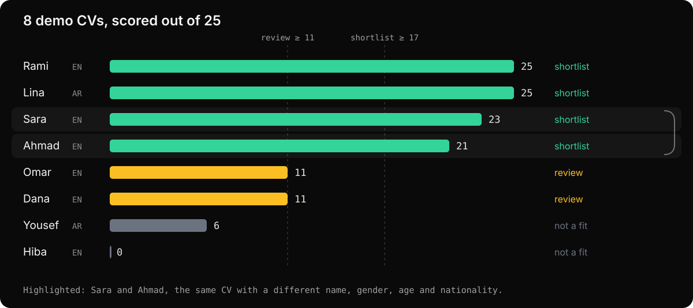
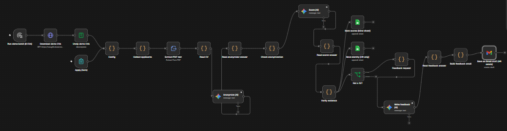

> **Demo · fictional company, fictional applicants.** Day 2 of my *7 Days · 7 Projects* challenge.

An applicant uploads a CV through a form. Before anything scores it, the workflow removes the name, gender, age, nationality, marital status, address and photo. Then a model scores the anonymous CV against a 5-point rubric, and **every score has to come with a sentence copied from the CV**. Code checks that the sentence is really there. Scores go to one sheet, names to another, and every rejected applicant gets a short, specific feedback email, saved as a **draft** for HR to read and send.

Small companies screen CVs by eye, and the name, the photo and the age are on the page before the experience is. Most applicants never hear back at all.

## What happens to each CV

From the 8 demo CVs, in Arabic and English:

| CV | What the workflow does |
|---|---|
| **Lina**, Arabic, 3 years in paid ads | **→ 25/25, shortlist.** The PDF text came out with reversed letters («انيل بيطخلا»). The anonymizer repaired it, and every Arabic quote was verified against the repaired text. |
| **Sara** and **Ahmad**, the same CV | **→ 23 and 21, both shortlist.** Same experience, different name, gender, age and nationality. The scorer saw two anonymized CVs that were almost identical. [More below.](#the-matched-pair) |
| **Dana**, *"results-driven, passionate expert"* | **→ 11/25, review.** The rubric says vague claims score at most 2, and the model still gave a 3 to *"Improved brand awareness and engagement significantly."* Code can check that a quote exists, not how strong it is. That's why the quote sits next to the score in the sheet. |
| **Yousef**, Arabic, graphic designer | **→ 6/25, not a fit.** A Gmail draft in Arabic with two points specific to this CV: show paid campaigns with budgets and results, not only the design side, and add analytics such as Google Analytics. |
| A score with a quote that isn't in the CV | **→ Scored 0 and flagged.** It counts against the model, not the applicant. |
| A name that slips through the anonymizer | **→ Removed by code and flagged.** A check runs on the anonymized text before the scorer sees it. |

## The result

The blind sheet has one row per applicant: an ID like `C-4A488L`, the five scores, the total, the suggested verdict, the quote behind each score, and any flags. It has no names. The names are in a second sheet that only HR opens, linked by the same ID.

## The workflow

Two triggers: the **form** for real applicants, and **Run demo batch**, which downloads the 8 demo CVs from this repo. Code nodes do the rules. The three *(AI)* nodes are the only model calls, and each one is followed by a Code node that checks what came back.

## The decisions

This project was documented with **Architecture Decision Records**: one short file for each decision, with the options I didn't take and why. Each ADR is in [`docs/adr`](docs/adr).

| # | Decision | In one line |
|---|---|---|
| [001](docs/adr/001-repair-arabic-pdf-text.md) | **Repair Arabic PDF text** before anything reads it | PDFs give Arabic back reversed. Code fixes one kind of damage, the anonymizer fixes the other. |
| [002](docs/adr/002-anonymize-before-scoring.md) | **Anonymize before scoring**, in three layers | Code removes what it knows, a model removes the rest, code checks again. The scorer never sees a name. |
| [003](docs/adr/003-verify-quotes-in-code.md) | **Verify every quote in code** | No quote in the CV, no points. Totals and verdicts are computed by code, not by the model. |
| [004](docs/adr/004-human-makes-the-decision.md) | **A person makes the decision** | Feedback is a Gmail draft, never sent automatically. The verdict is a suggestion. |
| [005](docs/adr/005-run-on-n8n-free-ai-credits.md) | **Run on n8n's free AI credits** | The free Gemini key allows 20 requests a day. The demo needs 19. |

## The matched pair

The plan's hardest test: two CVs with the same experience, word for word, one from *Ahmad Mansour, male, 37, Jordanian, married with 3 children* and one from *Sara Mansour, female, 26, Syrian, single*. The goal was the same score within ±0.5.

| Run | Ahmad | Sara | What happened |
|---|---|---|---|
| #19 | 23 | 18 | The model wrote `evidence_year` instead of `evidence_quote` on one of Sara's criteria, so the check found no quote and gave 0. **A bug in my code**, now fixed (ADR-005). |
| #20 | 21 | 23 | No bug. The same sentence, *"3 years of experience"*, got a 3 for Ahmad and a 5 for Sara. |
| #21 | 21 | 23 | The same again, on the same criterion. |

**The criterion failed: 2 points apart, not 0.5.** But the anonymized texts the scorer received were the same apart from a `[removed]` here and there, so it couldn't have known which one was Sara. The gap is the model's own inconsistency on a borderline score (the rubric says 3 for 1–2 years and 5 for 3+ years), and two runs in a row came out the same way, so I can't rule out that something in the anonymized text tips it. Ahmad and Sara got the same verdict every time. Dana shows the same instability from the other side: 11 (review) in run #20 and 10 (not a fit) in run #21, from the same CV. A fair screen needs a stable scorer as well as a blind one, and that's the next thing I'd fix: score each CV twice and flag criteria where the two runs disagree.

## What I'd tell you before you use it

- **The verdict is a suggestion.** Shortlist and review mean "read this one first". Nothing is decided automatically, and no email is sent.
- **Scanned CVs don't work.** A photo of a CV has no text in it. That needs OCR, which this version doesn't do.
- **The anonymizer is a model.** Code catches emails, phones, the applicant's own name and labelled fields like *Nationality:*. It can't catch every way a CV hints at identity, such as a women's college or a religious charity in the volunteering section.
- **University and company names stay.** They're job evidence. A blind screen hides who someone is, not where they've been.
- **Arabic grammar carries gender.** The anonymizer turns feminine forms into the masculine-generic form, and in the last run it did. That depends on the model, not on code.

## Run it yourself

1. In n8n, go to **Workflows → Import from File** and choose [`workflow.json`](workflow.json).
2. Create two Google Sheets with these headers in row 1:
   - **Scores:** `candidate_id, submitted_at, cv_language, total_25, verdict, paid_ads, content_social, analytics, bilingual_writing, relevant_experience, evidence, flags`
   - **Identities:** `candidate_id, name, email, submitted_at, cv_file`
3. In the **Config** node, set `candidates_sheet_id`, `identities_sheet_id` and `sheet_tab` (the tab's name). The job, the rubric and the thresholds are in the same node.
4. Connect **Google Sheets** and **Gmail**. On the three *(AI)* nodes choose **n8n free credits** (n8n Cloud), or your own Google Gemini key.
5. Click **Run demo batch (8 CVs)** and **Execute workflow**. It takes about a minute. Then open the **Apply (form)** node and use its form URL for real applicants.

This export contains no credentials or webhook IDs. Personal IDs are replaced with placeholders, and [a check](scripts/check-clean.mjs) runs on every push. The demo CVs and their generator are in [`data/cvs`](data/cvs) and [`dev/make-cvs.mjs`](dev/make-cvs.mjs).

## العربية

المتقدّم بيرفع سيرته الذاتية من فورم. قبل ما أي إشي يقيّمها، النظام بيشيل الاسم والجنس والعمر والجنسية والحالة الاجتماعية والعنوان والصورة. بعدين الموديل بيقيّم السيرة المجهولة على 5 معايير، **وكل علامة لازم يكون معها جملة منقولة حرفياً من السيرة**، والكود بيتأكد إنها موجودة فعلاً. العلامات بتنحفظ بشيت، والأسماء بشيت تاني منفصل. وكل متقدّم ما انقبل بيتجهّزله إيميل فيه نقطتين محددتين للتطوير، **كمسودة** بيقرأها الـ HR قبل ما يبعتها.

أصعب اختبار كان سيرتين متطابقتين حرفياً، وحدة لأحمد ووحدة لسارة. الفرق بينهم طلع علامتين بدل نص علامة. السبب مش إنو الموديل عرف مين سارة (النص اللي وصله كان نفسه)، السبب إنو الموديل نفسه مش ثابت بعلاماته على المعيار الحدّي. كتبت هالنتيجة زي ما هي، لأنها بالزبط الإشي اللي الاختبار معمول ليكشفه.

المشروع تجريبي على شركة خيالية ومتقدمين خياليين، وهو اليوم التاني من تحدي "7 أيام · 7 مشاريع". التوثيق بطريقة **ADR**: ملف قصير لكل قرار، فيه البدائل اللي ما اخترتها وليش.

---

Built by <a href="https://portfolio-mauve-seven-44.vercel.app/"><b>Tala Safadi</b></a>, AI Engineer · <a href="https://www.linkedin.com/in/talasfdi">LinkedIn</a> More systems: <a href="https://github.com/Sfditala/review-to-kitchen-report">Review to Kitchen Report</a> · <a href="https://github.com/Sfditala/clinic-ai-receptionist">Clinic AI Receptionist</a> · <a href="https://github.com/Sfditala/ai-marketing-team">AI Marketing Team</a>

